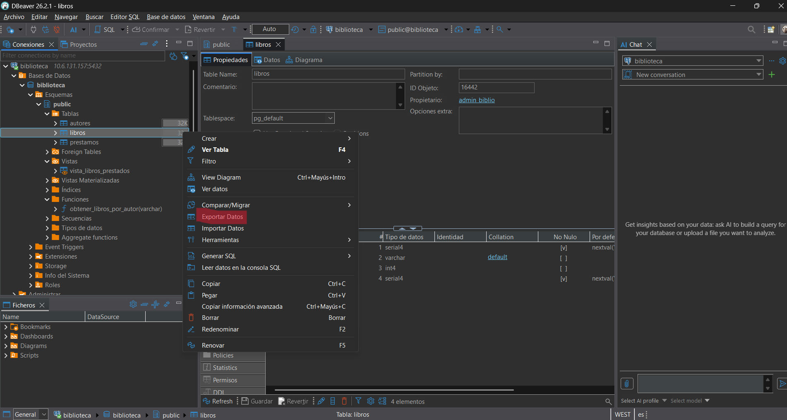
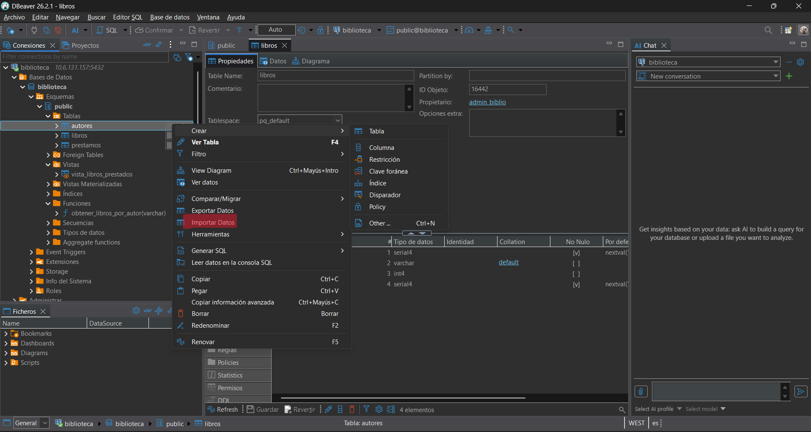
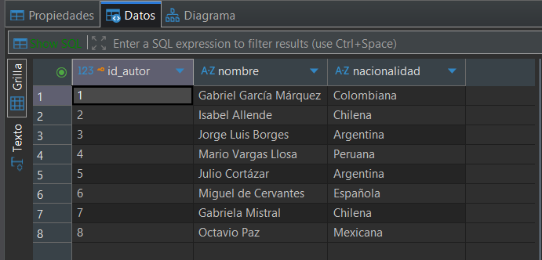

# Práctica 1.Conceptos fundamentales de PostgreSQL
### Autores: Alejandro Dorta Luis y Francisco Ortiz López

Iniciar servicio PostgreSQL
```sql
sudo service postgresql start 
sudo -u postgres psql
```
## 1. Creación de la base de datos
  * ### Crear una base de datos llamada biblioteca
    ```sql
    postgres=# CREATE DATABASE biblioteca;
    CREATE DATABASE
    ```

## 2.  Creación de usuarios
  * ### Crear dos usarios
    - admin_biblio con permisos de administrador sobre la base de datos.
      ```sql
      postgres=# CREATE USER admin_biblio WITH LOGIN PASSWORD 'admin_biblio';
      CREATE ROLE
      
      -- Le damos la propiedad de la base de datos
      postgres=# ALTER DATABASE biblioteca OWNER TO admin_biblio;
      GRANT
      ```
    - usuario_biblio con permisos solo de lectura.
      ```sql
      postgres=# CREATE USER usuario_biblio WITH LOGIN PASSWORD 'usuario_biblio';
      CREATE ROLE
      postgres=# GRANT CONNECT ON DATABASE biblioteca TO usuario_biblio;
      GRANT
      
      -- Entramos a la base de datos biblioteca con el administrador pra darle los permisos de lectura 
      sudo psql -U admin_biblio -d biblioteca -h localhost
      biblioteca=> GRANT USAGE ON SCHEMA public TO usuario_biblio;
      GRANT
      biblioteca=> GRANT SELECT ON ALL TABLES IN SCHEMA public TO usuario_biblio;
      GRANT
      ```
    
  * ### Crear un rol llamado lectores con permisos únicamente de consulta sobre todas las tablas de la base de datos.
    ```sql
      --Le damos permiso al administrado para que puedo crear roles en la base de datos
       sudo psql -U postgres -d biblioteca -h localhost
       biblioteca=# ALTER ROLE admin_biblio with CREATEROLE;
      ALTER ROLE
    
      --Creamos el rol y la damos permisos de consulta
      sudo psql -U admin_biblio -d biblioteca -h localhost
      biblioteca=> CREATE ROLE lectores NOLOGIN;
      CREATE ROLE
      biblioteca=> GRANT SELECT ON ALL TABLES IN SCHEMA public TO lectores;
      GRANT
      biblioteca=> ALTER DEFAULT PRIVILEGES IN SCHEMA public
      biblioteca-> GRANT SELECT ON TABLES TO lectores;
      ALTER DEFAULT PRIVILEGES
      ```

  * ### Asignar el usuario usuario_biblio a este rol.
      ```sql
      biblioteca=> GRANT lectores TO usuario_biblio;
      GRANT ROLE
      ```

  * ### Consultar las tablas del sistema para listar todos los usuarios creados (pg_roles).
    ```sql
    biblioteca=> SELECT usename FROM pg_user;
    usename
    ----------------
    postgres
    mydb_admin
    usuario_biblio
    admin_biblio
    (4 rows)
    ```

  * ### Cambiar la contraseña del usuario usuario_biblio.
    ```sql
    biblioteca=# \password usuario_biblio
    Enter new password for user "usuario_biblio":
    Enter it again:
    ```
  * ### Configurar permisos de tal forma que el usuario usuario_biblio no pueda eliminar registros en ninguna tabla.
    ```sql
    biblioteca=# ALTER DEFAULT PRIVILEGES IN SCHEMA public
    biblioteca-# REVOKE DELETE ON TABLES FROM usuario_biblio
    ```

## 3. Creación de tablas
  * ### Crear las siguinetes tablas con sus respectiva claves primarias y foraneas
    - **autores**(id_autor, nombre, nacionalidad)
      ```sql
      biblioteca=> CREATE TABLE autores (
      id_autor SERIAL PRIMARY KEY,
      nombre VARCHAR,
      nacionalidad VARCHAR );
      CREATE TABLE
      ```

    - **libros**(id_libro, titulo, año_publicación, id_autor)
      ```sql
      #libros(id_libro, titulo, año_publicacion, id_autor)
      biblioteca=> CREATE TABLE libros (
      id_libro SERIAL PRIMARY KEY,
      titulo VARCHAR,
      año_publicacion INT, 
      id_autor SERIAL,
      FOREIGN KEY (id_autor) REFERENCES autores(id_autor) );
      CREATE TABLE
      ```
    - **prestamos**(id_prestamos, id_libro, fecha_prestamo, fecha_devolución, usuario_prestatario)
      ```sql
      biblioteca=> CREATE TABLE prestamos(
      id_prestamo SERIAL PRIMARY KEY,
      id_libro SERIAL,
      FOREIGN KEY (id_libro) REFERENCES libros(id_libro),
      fecha_prestamo DATE,
      fecha_devolucion DATE,
      usuario_prestatario VARCHAR );
      CREATE TABLE
      ```
## 4. Inserción de datos
  * ### Insertar al menos 5 autores, 8 libros y 5 préstamos de ejemplo
    - **autores**
      ```sql
      biblioteca=> INSERT INTO autores (id_autor, nombre, nacionalidad) VALUES
      (1, 'Gabriel García Márquez', 'Colombiana'),
      (2, 'Isabel Allende', 'Chilena'),
      (3, 'Jorge Luis Borges', 'Argentina'),
      (4, 'Mario Vargas Llosa', 'Peruana'),
      (5, 'Julio Cortázar', 'Argentina');
      INSERT 0 5
      '''
      
    - **libros**
      ```sql
      biblioteca=> INSERT INTO libros (id_libro, titulo, año_publicacion, id_autor) VALUES
      (1, 'Cien años de soledad', 1967, 1),
      (2, 'El amor en los tiempos del cólera', 1985, 1),
      (3, 'La casa de los espíritus', 1982, 2),
      (4, 'Largo pétalo de mar', 2019, 2),
      (5, 'Ficciones', 1944, 3),
      (6, 'El Aleph', 1949, 3),
      (7, 'La ciudad y los perros', 1963, 4),
      (8, 'Rayuela', 1963, 5);
      INSERT 0 8
      '''

    - **préstamos**
      ```sql
      biblioteca=> INSERT INTO prestamos (id_prestamo, id_libro, fecha_prestamo, fecha_devolucion, usuario_prestatario) VALUES
      (1, 1, '2026-01-10', '2026-01-24', 'Ana Gómez'),
      (2, 3, '2026-01-15', '2026-01-29', 'Carlos López'),
      (3, 5, '2026-02-01', NULL, 'María Rodríguez'),
      (4, 7, '2026-02-05', '2026-02-19', 'Juan Pérez'),
      (5, 8, '2026-02-10', NULL, 'Laura Martínez');
      INSERT 0 5
      ```


## 5. Consultas básicas
  * ### Listar todos los libros con su autor correspondiente
    ```sql
    biblioteca=> SELECT libros.titulo, autores.nombre
    FROM libros
    JOIN autores ON libros.id_autor = autores.id_autor;


                  titulo               |         nombre
    -----------------------------------+------------------------
     Cien años de soledad              | Gabriel García Márquez
     El amor en los tiempos del cólera | Gabriel García Márquez
     La casa de los espíritus          | Isabel Allende
     Largo pétalo de mar               | Isabel Allende
     Ficciones                         | Jorge Luis Borges
     El Aleph                          | Jorge Luis Borges
     La ciudad y los perros            | Mario Vargas Llosa
     Rayuela                           | Julio Cortázar
    (8 rows)
    ```

  * ### Mostrar los préstamos que aún no tienen fecha de devolución
    ```sql
    biblioteca=> SELECT *
    biblioteca-> FROM prestamos
    biblioteca-> WHERE fecha_devolucion IS NULL;

    
     id_prestamo | id_libro | fecha_prestamo | fecha_devolucion | usuario_prestatario
    -------------+----------+----------------+------------------+---------------------
               3 |        5 | 2026-02-01     |                  | María Rodríguez
               5 |        8 | 2026-02-10     |                  | Laura Martínez
    (2 rows)
    ```
    
  * ### Obtener autores que tienen más de u libro registrado
    ```sql
    biblioteca=> SELECT
        a.id_autor,
        a.nombre,
        COUNT(l.id_libro) AS total_libros
    FROM autores a
    JOIN libros l ON a.id_autor = l.id_autor
    GROUP BY a.id_autor, a.nombre
    HAVING COUNT(l.id_libro) > 1;

    
     id_autor |         nombre         | total_libros
    ----------+------------------------+--------------
            2 | Isabel Allende         |            2
            3 | Jorge Luis Borges      |            2
            1 | Gabriel García Márquez |            2
    (3 rows)
    ```

## 6. Consultas con agregación
  * ### Calcular el número total de préstamos realizados
    ```sql
    biblioteca=> SELECT COUNT(*)
    biblioteca-> FROM prestamos;

    
     count
    -------
         5
    (1 row)
    ```
    
  * ### Obtener el número de libros prestados por cada usuario
    ```sql
    biblioteca=> SELECT
        usuario_prestatario,
        COUNT(id_prestamo) AS total_libros_prestados
    FROM prestamos
    GROUP BY usuario_prestatario;
     usuario_prestatario | total_libros_prestados

    
    ---------------------+------------------------
     Ana Gómez           |                      1
     Juan Pérez          |                      1
     Carlos López        |                      1
     Laura Martínez      |                      1
     María Rodríguez     |                      1
     ```


# 7. Modificación de datos
  * ### Actualizar la fecha de devolución de un préstamo pendiente
    ```sql
    biblioteca=> UPDATE prestamos
    SET fecha_devolucion = '2026-02-15'
    WHERE id_prestamo = 3;
    UPDATE 1
    ```
    
  * ### Eliminar un libro y comprobar el efeto en la tabla de préstamos (usar ON DELETE CASCADE o justificar el comportamineto
    ```sql
    biblioteca=> ALTER TABLE prestamos
    ADD CONSTRAINT fk_prestamos_libros
    FOREIGN KEY (id_libro)
    REFERENCES libros(id_libro)
    ON DELETE CASCADE;
    ALTER TABLE
    biblioteca=> DELETE FROM prestamos
    biblioteca-> WHERE id_libro = 5;
    DELETE 1
    biblioteca=> SELECT *
    biblioteca-> FROM prestamos;
    
    
     id_prestamo | id_libro | fecha_prestamo | fecha_devolucion | usuario_prestatario
    -------------+----------+----------------+------------------+---------------------
               1 |        1 | 2026-01-10     | 2026-01-24       | Ana Gómez
               2 |        3 | 2026-01-15     | 2026-01-29       | Carlos López
               4 |        7 | 2026-02-05     | 2026-02-19       | Juan Pérez
               5 |        8 | 2026-02-10     |                  | Laura Martínez
    (4 rows)
    ```

# 8. Creación de vistas 
  * ### Crear una vista llamada vista_libros_prestados que muestre: título del libro, autor y nombre del prestatario
    ```sql
    biblioteca=> CREATE VIEW vista_libros_prestados
    AS
    SELECT libros.titulo, autores.nombre, prestamos.usuario_prestatario
    FROM autores NATURAL JOIN libros NATURAL JOIN prestamos;
    CREATE VIEW
    ```

  * ### Conceder permisos de consulta sobre eta vista únicamente a usuario_biblio
    ```sql
    biblioteca=> GRANT SELECT ON vista_libros_prestados TO usuario_biblio;
    GRANT
    ```

# 9. Funciones y consultas avanzadas
  * ### Crear una función que reciba el nombre de un autor y devuelva todos los libros escritos por él
    ```sql
    biblioteca=> CREATE OR REPLACE FUNCTION obtener_libros_por_autor(nombre_buscado VARCHAR)
    RETURNS TABLE (
        id_libro INT,
        titulo VARCHAR,
        año_publicacion INT
    ) AS $$
    BEGIN
        RETURN QUERY
        SELECT
            l.id_libro,
            l.titulo,
            l.año_publicacion
        FROM libros l
        JOIN autores a ON l.id_autor = a.id_autor
        WHERE a.nombre ILIKE '%' || nombre_buscado || '%';
    END;
    $$ LANGUAGE plpgsql;
    CREATE FUNCTION
    biblioteca=> SELECT * FROM obtener_libros_por_autor('Gabriel García Márquez');

    
     id_libro |              titulo               | año_publicacion
    ----------+-----------------------------------+-----------------
            1 | Cien años de soledad              |            1967
            2 | El amor en los tiempos del cólera |            1985
    (2 rows)
    ```
  * ### Crear una consulta que devuelva los tres libros más prestados
    ```sql
    biblioteca=> SELECT
        l.id_libro,
        l.titulo,
        a.nombre AS autor,
        COUNT(p.id_prestamo) AS total_prestamos
    FROM prestamos p
    JOIN libros l ON p.id_libro = l.id_libro
    JOIN autores a ON l.id_autor = a.id_autor
    GROUP BY l.id_libro, l.titulo, a.nombre
    ORDER BY total_prestamos DESC
    LIMIT 3

    
     id_libro |          titulo          |         autor          | total_prestamos
    ----------+--------------------------+------------------------+-----------------
            3 | La casa de los espíritus | Isabel Allende         |               1
            1 | Cien años de soledad     | Gabriel García Márquez |               1
            7 | La ciudad y los perros   | Mario Vargas Llosa     |               1
    (3 rows)
    ```

# 10. Exportación e importación de datos
  * ### Exportar el contenido de la talla libros a un archivo CSV
    
  * ### Importar datos adicionales de autores desde un archivo CDV externo
    
    
